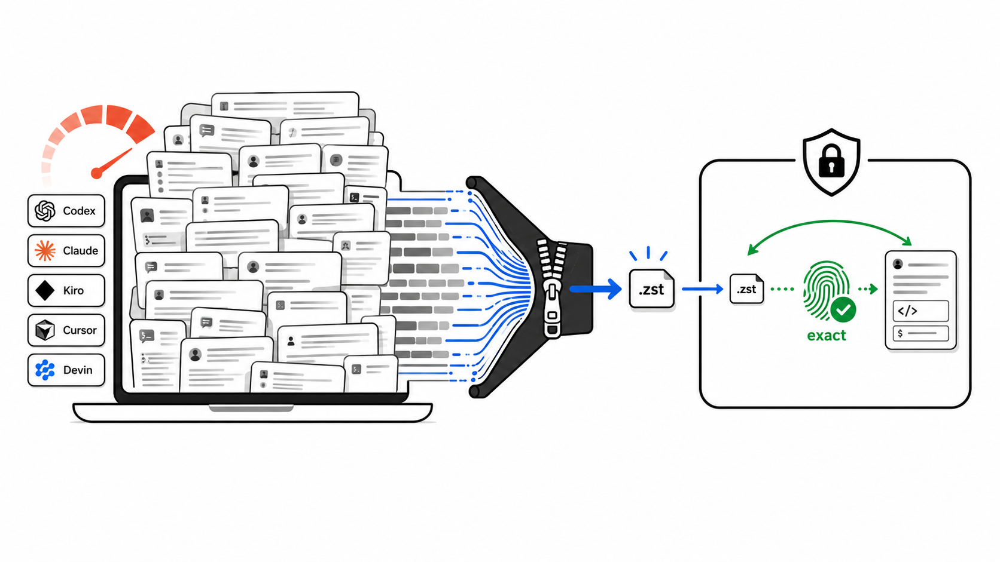
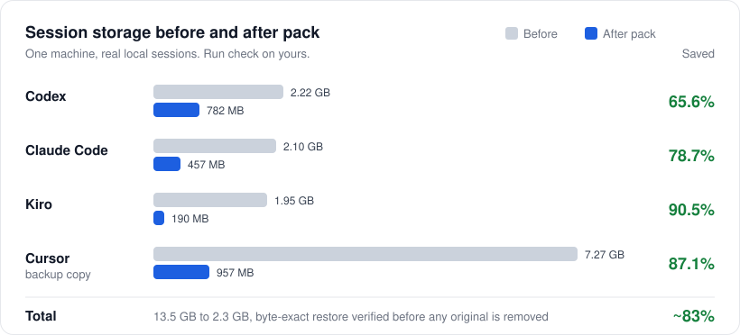

<p align="center">
  <a href="https://github.com/YosefHayim/agent-session-pack"></a>
</p>

<p align="center">
  <strong>Almacenamiento en frío para las sesiones locales de agentes de código con IA. Reduce en disco el historial de Codex, Claude Code, Kiro, Grok, Kimi, OpenCode y Gemini CLI, y recupera cada byte al restaurar.</strong>
</p>

<p align="center">
  <a href="https://www.npmjs.com/package/agent-session-pack"></a>
  <a href="https://www.npmjs.com/package/agent-session-pack"></a>
  <a href="https://github.com/YosefHayim/agent-session-pack/actions/workflows/ci.yml"></a>
  <a href="LICENSE"></a>
  
</p>

<p align="center">
  
  
  
  
</p>

<p align="center">
  <a href="README.md">English</a> · <a href="README.ja.md">日本語</a> · <a href="README.he.md">עברית</a> · <strong>Español</strong> · <a href="README.zh-CN.md">简体中文</a>
</p>

---

**Agent Session Pack** es una CLI de [Node.js](https://nodejs.org/en) para desarrolladores y agentes de código cuyo historial local de sesiones ha crecido mucho. Encuentra los almacenes de sesiones de [OpenAI Codex CLI](https://developers.openai.com/codex/cli), [Claude Code](https://code.claude.com/docs/en/overview), [Kiro CLI](https://kiro.dev/docs/cli/), [Grok](https://grok.x.ai/), [Kimi Code](https://www.kimi.com/), [OpenCode](https://opencode.ai/), [Gemini CLI](https://geminicli.com/), [Cursor](https://cursor.com/docs) y [Devin CLI](https://docs.devin.ai/cli), demuestra la compresión sin pérdida [Zstandard](https://facebook.github.io/zstd/) sobre copias, y empaqueta las sesiones frías en un almacén local solo cuando tú lo pides. Cada empaquetado restaura el archivo y compara los hashes SHA-256 antes de eliminar un archivo original.

Sin demonio, sin sincronización en la nube, sin resúmenes. Tus sesiones nunca salen de tu equipo.

## Índice

- [Características](#características)
- [Agentes compatibles](#agentes-compatibles)
- [Resultados](#resultados)
- [Agent Session Pack frente a borrar o comprimir](#agent-session-pack-frente-a-borrar-o-comprimir)
- [Configuración con IA en un clic](#configuración-con-ia-en-un-clic)
- [Inicio rápido](#inicio-rápido)
- [Comandos](#comandos)
- [Ciclo de vida: restauración automática al abrir](#ciclo-de-vida-restauración-automática-al-abrir)
- [Modelo de seguridad](#modelo-de-seguridad)
- [Hola mundo](#hola-mundo)
- [Alternativas](#alternativas)
- [Preguntas frecuentes](#preguntas-frecuentes)
- [Contribuir](#contribuir)
- [Recursos](#recursos)
- [Licencia](#licencia)
- [Colaboradores](#colaboradores)

## Características

- **9 agentes de código** - Codex, Claude Code, Kiro, Grok, Kimi Code, OpenCode y Gemini CLI se empaquetan y restauran; Cursor y Devin son solo de copia de seguridad.
- **Prueba antes del cambio** - `check` copia una sesión por agente, la comprime, la restaura y compara los hashes. Los archivos reales no se tocan.
- **Restauración byte a byte** - cada archivo se restaura y se verifica con SHA-256 antes de eliminar el original.
- **Vista previa por defecto** - nada se elimina sin `--apply`, y `--apply` pregunta antes salvo que pases `--yes`.
- **Filtro de sesiones frías** - `--older-than 7d` (o `12h`, `1d`, `2w`, `30d`) deja intacto tu trabajo activo.
- **Hecho para agentes** - `guide --json` imprime el mapa de comandos seguros, y los comandos scan, check, pack, unpack, restore y lifecycle tienen salida `--json` estable y sin preguntas.
- **Ciclo de vida opcional** - los envoltorios de los proveedores restauran una sesión empaquetada cuando la abres, y `maintain` vuelve a empaquetar las frías.
- **Primero en local** - sin demonio, sin red, sin leer credenciales.

## Agentes compatibles

| Agente | Modo | Almacén de sesiones |
| --- | --- | --- |
| Codex | Archivo | `~/.codex/sessions` |
| Claude Code | Archivo | `~/.claude/projects` |
| Kiro | Archivo | `~/.kiro/sessions` |
| Grok | Archivo | `~/.grok/sessions` (carpetas completas de sesión) |
| Kimi Code | Archivo | `~/.kimi-code/sessions` (carpetas completas de sesión) |
| OpenCode | Archivo | `~/.local/share/opencode`, `~/.opencode` |
| Gemini CLI | Archivo | `~/.gemini`, `~/.gemini/tmp` |
| Cursor | Solo copia de seguridad | `~/Library/Application Support/Cursor` |
| Devin | Solo copia de seguridad | `~/.local/share/devin/cli` (lee solo los metadatos de `sessions.db`) |

**Archivo** significa que las sesiones se pueden empaquetar en el almacén y restaurar. **Solo copia de seguridad** significa que el agente aparece como compatible, pero su almacén nativo nunca se modifica. El descubrimiento de Cursor de momento no devuelve sesiones.

## Resultados

<p align="center">
  
</p>

| Agente | Antes | Después | Ahorro |
| --- | ---: | ---: | ---: |
| Codex | 2.22 GB | 782 MB | **65.6%** |
| Claude Code | 2.10 GB | 457 MB | **78.7%** |
| Kiro | 1.95 GB | 190 MB | **90.5%** |
| Cursor (copia de seguridad) | 7.27 GB | 957 MB | **87.1%** |
| **Total** | **13.5 GB** | **2.3 GB** | **~83%** |

Este es el historial real de sesiones de un solo equipo, no un benchmark universal. Ejecuta `npx --yes agent-session-pack check` para medir el tuyo; solo funciona sobre copias.

## Agent Session Pack frente a borrar o comprimir

| | **Agent Session Pack** | **Borrar archivos viejos** | **zstd o tar a mano** |
| --- | --- | --- | --- |
| Recuperar la sesión | Byte a byte, verificada antes de eliminar | Perdida para siempre | Solo si lo compruebas tú |
| Encuentra el almacén de cada agente | Integrado para 9 agentes | Tienes que buscar las rutas | Tienes que buscar las rutas |
| Devuelve los archivos a donde el agente los espera | Manifiesto de restauración por sesión | No aplica | Tú llevas las rutas |
| Archivos modificados al restaurar | Se omiten, nunca se sobrescriben | No aplica | Se sobrescriben en silencio |
| Sesiones de varios archivos (Grok, Kimi) | Se empaquetan como carpetas completas | Fácil de borrar a medias | Fácil olvidar archivos |
| Ver antes | La vista previa es el valor por defecto | No | No |

## Configuración con IA en un clic

> **Deja que tu agente de código lo ejecute por ti.** Copia el siguiente prompt en Claude Code, Codex o en cualquier agente con terminal.

<details>
<summary><strong>Haz clic para copiar el prompt de configuración con IA</strong></summary>

```
I want to free disk space used by my local AI coding-agent sessions with
Agent Session Pack (https://github.com/YosefHayim/agent-session-pack).

Please:
1. Check that Node.js 22+ and zstd are installed. If zstd is missing, tell me how to install it on my OS.
2. Run: npx --yes agent-session-pack guide --json
   and follow its safe command map.
3. Run: npx --yes agent-session-pack check --json
   and show me the before/after savings per agent. This only touches copies.
4. Run: npx --yes agent-session-pack pack --all-providers --older-than 7d --dry-run --json
   and show me which sessions would be packed.
5. Stop and ask me before running anything with --apply.
```

</details>

## Inicio rápido

### 1. Revisa los requisitos

- [Node.js](https://nodejs.org/en) 22 o más reciente.
- [`zstd`](https://facebook.github.io/zstd/) en tu `PATH` para la prueba, el empaquetado y la restauración.
- `sqlite3` solo si usas Devin.
- `HOME` definido en tu terminal (normal en macOS y Linux; mira [`.env.example`](.env.example)).

Ejecuta `npx --yes agent-session-pack doctor` para comprobarlos.

### 2. Demuestra el ahorro sobre copias

```bash
npx --yes agent-session-pack check
```

`check` copia una sesión por agente a un espacio temporal, la comprime, la restaura, compara los hashes e imprime una tabla de antes y después. Los archivos de sesión reales no se tocan.

### 3. Previsualiza lo que se empaquetaría

```bash
npx --yes agent-session-pack pack --all-providers --older-than 7d --dry-run
```

### 4. Empaqueta las sesiones frías

```bash
npx --yes agent-session-pack pack --all-providers --older-than 7d --apply
```

Cada sesión se archiva en `~/.agent-session-pack`, se restaura y se verifica con hash, se registra en un manifiesto y solo entonces se elimina del almacén del agente.

### 5. Restaura cuando lo necesites

```bash
npx --yes agent-session-pack unpack --all-providers --apply   # todo
npx --yes agent-session-pack restore SESSION_ID_OR_NAME       # una sesión
```

`restore` y `open` aceptan un id de sesión o sus primeros caracteres, el nombre, el slug o unas palabras del nombre. Añade un prefijo como `codex:` para buscar en un solo agente. Si coincide más de una sesión, no se restaura nada y se listan las coincidencias.

¿Prefieres un menú guiado? Ejecuta `npx --yes agent-session-pack` sin argumentos en una terminal. Para tener el comando en tu ruta, instálalo globalmente con `npm install -g agent-session-pack`.

## Comandos

| Comando | Qué hace | Cambia archivos |
| --- | --- | --- |
| `guide [--json]` | Mapa de comandos seguros para agentes y automatización | No |
| `check [--json]` | Prueba de ahorro sin instalar, sobre copias | No |
| `savings [--json]` | La misma prueba de antes y después solo sobre copias | No |
| `scan [--json]` | Lista los almacenes de sesiones, tamaños y candidatas frías | No |
| `doctor [--json]` | Comprueba que `zstd` y `sqlite3` estén instalados | No |
| `init` | Muestra la política del almacén; en una terminal abre la configuración guiada que escribe la configuración | Solo configuración |
| `pack --dry-run` | Previsualiza las sesiones frías que se empaquetarían | No |
| `pack --apply [--yes]` | Archiva, verifica y luego elimina los originales | Sí |
| `unpack --apply [--yes]` | Restaura las sesiones archivadas a sus rutas originales | Sí |
| `restore <selector>` | Restaura una sesión por id, prefijo de id, nombre, slug o palabras de su nombre | Sí |
| `open <session>` | Busca una sesión del mismo modo y la restaura si está empaquetada | Sí |
| `lifecycle enable\|disable\|status` | Instala o elimina los envoltorios de restauración automática | Envoltorios y configuración |
| `maintain --apply [--yes]` | Vuelve a empaquetar las sesiones que se enfriaron otra vez | Sí |

`preflight`, `watch` y `ensure-restored` los llaman los envoltorios del ciclo de vida; rara vez los ejecutas tú.

Opciones comunes: `--provider <id>`, `--all-providers`, `--older-than`, `--json`. Los ids de agente son `codex`, `claude`, `kiro`, `grok`, `kimi`, `opencode`, `gemini`, `cursor` y `devin`.

<details>
<summary><strong>Cómo elegir <code>--older-than</code></strong></summary>

| Valor | Úsalo para |
| --- | --- |
| `12h` | Una ventana corta de limpieza |
| `1d` | Dejar fuera más o menos el trabajo activo de hoy |
| `7d` | La política por defecto de la configuración |
| `30d` | Una pasada conservadora de archivo |
| `--max --dry-run` | Vista previa por curiosidad de todas las sesiones en modo archivo (nunca con `--apply`) |

</details>

`npx --yes` solo aprueba la descarga temporal del paquete de npm. Agent Session Pack pide su propia confirmación mediante `--apply` y, para automatizaciones, `--yes`.

## Ciclo de vida: restauración automática al abrir

El ciclo de vida está apagado hasta que lo actives. Una vez activo, las sesiones empaquetadas vuelven solas cuando un agente las abre.

```bash
# una vez
npx --yes agent-session-pack lifecycle enable --json
export PATH="$HOME/.agent-session-pack/bin:$PATH"

# abre o reanuda una sesión (la restaura antes si está empaquetada)
npx --yes agent-session-pack open --provider grok SESSION_ID --json

# mantén el almacenamiento bajo después de las restauraciones
npx --yes agent-session-pack maintain --apply --yes --json
```

- Los envoltorios (`codex`, `claude`, `grok`, ...) ejecutan `preflight` sobre los ids de sesión de la línea de comandos y luego `watch` mientras el agente funciona.
- Las sesiones empaquetadas dejan pequeños stubs para que sigan apareciendo en la lista. Cuando el agente abre un stub, `watch` restaura la sesión completa.
- `maintain` vuelve a empaquetar las sesiones más antiguas que tu `coldAfter` configurado (por defecto `7d`). No hay demonio; si quieres, prográmalo con cron o launchd.
- `lifecycle disable` elimina los envoltorios.

## Modelo de seguridad

Agent Session Pack está construido alrededor de la restauración byte a byte, no de una limpieza de mejor esfuerzo.

- `check` y `savings` trabajan solo sobre copias.
- `pack --all-providers` es una simulación salvo que pases `--apply`.
- `pack --apply` pide confirmación en una terminal salvo que pases `--yes`.
- `pack --max --apply` se rechaza.
- Apply escribe el archivo, lo restaura, comprueba la igualdad SHA-256, escribe un manifiesto y solo entonces elimina el original.
- `unpack --apply` restaura desde los manifiestos y omite cualquier archivo activo que haya cambiado en lugar de sobrescribirlo.
- Las sesiones de Grok y Kimi son carpetas completas, así que se empaquetan y restauran como carpetas completas.
- Cursor y Devin son solo de copia de seguridad: sus almacenes nativos nunca se modifican.

## Hola mundo

[`examples/hello-world`](examples/hello-world/) contiene tres sesiones sintéticas pequeñas con sus archivos `zstd` reales y copias restauradas. Dos comandos demuestran que el archivo restaura los bytes exactos:

```bash
shasum -a 256 < examples/hello-world/before/codex-session.jsonl
zstd -d -c examples/hello-world/archives/codex-session.jsonl.zst | shasum -a 256
```

## Alternativas

Agent Session Pack es deliberadamente acotada: archiva archivos de sesión locales fríos y verifica la restauración byte a byte. Combina bien con herramientas de uso, búsqueda y análisis de disco.

| Herramienta | Enfoque principal | Diferencia |
| --- | --- | --- |
| [`ccusage`](https://ccusage.com/guide/) | Informes de tokens y costos de agentes de código | Explica el uso; no empaqueta almacenes de sesiones. |
| [`claude-code-history-viewer`](https://github.com/jhlee0409/claude-code-history-viewer) | Navegación y búsqueda sin conexión del historial de código con IA | Ve el historial; no archiva ni restaura. |
| [`claude-code-cleaner`](https://github.com/garrickz2/claude-code-cleaner) | Limpieza de disco de Claude Code | Solo Claude; sin un almacén verificado para varios agentes. |
| `zstd`, `tar`, copias de seguridad, analizadores de disco | Herramientas genéricas de almacenamiento | Comprimen o encuentran bytes; no conocen las sesiones de agentes ni las rutas de restauración. |

## Preguntas frecuentes

<details>
<summary><strong>¿Esto es compactación o resumen de contexto?</strong></summary>

No. Agent Session Pack nunca resume, reescribe ni trunca una conversación. Usa compresión sin pérdida y verifica la restauración byte a byte.
</details>

<details>
<summary><strong>¿Los agentes pueden seguir las sesiones después de empaquetarlas?</strong></summary>

Sí. Restaura una sesión con `restore` u `open` antes de reanudarla, o activa el [ciclo de vida](#ciclo-de-vida-restauración-automática-al-abrir) para que ocurra automáticamente cuando el agente la abra.
</details>

<details>
<summary><strong>¿La configuración comprime las sesiones sola más adelante?</strong></summary>

La configuración por sí sola solo guarda ajustes. El empaquetado ocurre cuando ejecutas `pack --apply`, o `maintain --apply` después de `lifecycle enable`. Nada se ejecuta en segundo plano.
</details>

<details>
<summary><strong>¿Cómo empaqueto las sesiones viejas y dejo fuera las de hoy?</strong></summary>

```bash
npx --yes agent-session-pack pack --all-providers --older-than 1d --apply
```
</details>

<details>
<summary><strong>¿Lee credenciales o sube sesiones?</strong></summary>

No. Escanea los almacenes locales y escribe archivos locales. Para Devin lee los metadatos de sesión de la base SQLite local y nunca lee credenciales.
</details>

<details>
<summary><strong>¿En qué se diferencia de borrar archivos de sesión viejos?</strong></summary>

Borrar es irreversible. Agent Session Pack escribe un archivo, demuestra que restaura los bytes exactos del original, escribe un manifiesto y solo entonces elimina el original.
</details>

<details>
<summary><strong>¿Dónde se guardan los archivos?</strong></summary>

En el almacén `~/.agent-session-pack`: archivos `.zst` comprimidos más un manifiesto JSON por sesión con la ruta original y el hash SHA-256.
</details>

## Contribuir

Las contribuciones son bienvenidas. Haz un fork, crea una rama, añade pruebas, ejecuta las comprobaciones, haz commit con [Conventional Commits](https://www.conventionalcommits.org/) y abre un PR. Las reglas para agentes están en [AGENTS.md](AGENTS.md).

```bash
pnpm install
pnpm check        # lint, typecheck, test y build con Turborepo
pnpm lint:fix     # escribe las correcciones de Biome
pnpm test:watch   # Vitest en modo watch; las pruebas usan solo datos sintéticos
pnpm dev          # ejecuta la CLI desde el código fuente, p. ej. pnpm dev doctor
pnpm prod         # compila y luego ejecuta la CLI compilada
```

Las pruebas nunca leen ni cambian tus carpetas reales de sesiones.

## Recursos

Documentación del proyecto:

- [PROJECT.md](PROJECT.md) - propósito, usuarios y no objetivos.
- [llms.txt](llms.txt) - un resumen compacto del proyecto para agentes de IA.
- [Versiones](https://github.com/YosefHayim/agent-session-pack/releases) y el [gestor de incidencias](https://github.com/YosefHayim/agent-session-pack/issues).

Construido con:

- [TypeScript](https://www.typescriptlang.org/), [Effect](https://effect.website/docs), [citty](https://github.com/unjs/citty) y [Clack](https://bomb.sh/docs/clack/basics/getting-started/).
- [pnpm](https://pnpm.io/), [Vitest](https://vitest.dev/), [Biome](https://biomejs.dev/), [tsup](https://tsup.egoist.dev/) y [GitHub Actions](https://docs.github.com/en/actions).
- [Zstandard](https://facebook.github.io/zstd/) y la convención [llms.txt](https://llmstxt.org/).

## Licencia

MIT - ver [LICENSE](LICENSE).

## Colaboradores

Gracias a todas las personas que han ayudado a mejorar este proyecto.

<a href="https://github.com/YosefHayim/agent-session-pack/graphs/contributors">
  
</a>

---

<div align="center">

<a href="https://www.buymeacoffee.com/yosefhayim" target="_blank"></a>

<br /><br />

**[Apoya este proyecto](https://www.buymeacoffee.com/yosefhayim)** · Creado por [Yosef Hayim Sabag](https://github.com/YosefHayim)

<sub>Agent Session Pack · almacenamiento en frío para las sesiones locales de agentes de código con IA · archivo zstd y restauración byte a byte para Codex, Claude Code, Kiro, Grok, Kimi, OpenCode y Gemini CLI.</sub>

</div>
