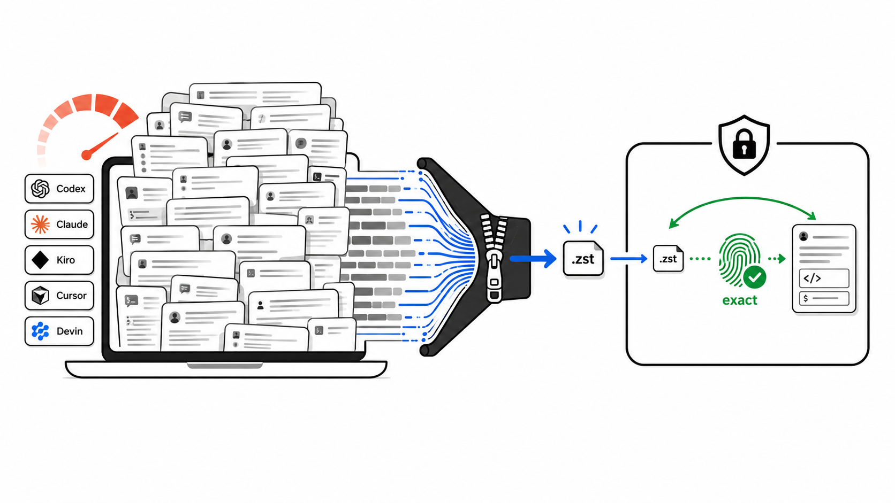
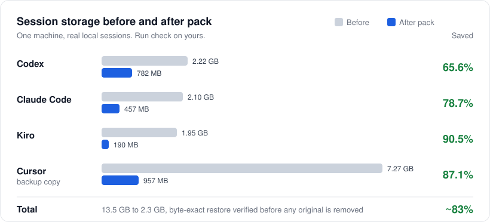

<div dir="rtl">

<p align="center">
  <a href="https://github.com/YosefHayim/agent-session-pack"></a>
</p>

<p align="center">
  <strong>אחסון קר לסשנים מקומיים של סוכני קוד AI. מכווץ את ההיסטוריה של Codex, Claude Code, Kiro, Grok, Kimi, OpenCode ו-Gemini CLI על הדיסק, ומחזיר כל בית בשחזור.</strong>
</p>

<p align="center">
  <a href="https://www.npmjs.com/package/agent-session-pack"></a>
  <a href="https://www.npmjs.com/package/agent-session-pack"></a>
  <a href="https://github.com/YosefHayim/agent-session-pack/actions/workflows/ci.yml"></a>
  <a href="LICENSE"></a>
  
</p>

<p align="center">
  
  
  
  
</p>

<p align="center">
  <a href="README.md">English</a> · <a href="README.ja.md">日本語</a> · <strong>עברית</strong> · <a href="README.es.md">Español</a> · <a href="README.zh-CN.md">简体中文</a>
</p>

---

**Agent Session Pack** הוא כלי CLI מבוסס [Node.js](https://nodejs.org/en) למפתחים ולסוכני קוד שההיסטוריה המקומית של הסשנים שלהם גדלה מאוד. הוא מוצא את אחסון הסשנים של [OpenAI Codex CLI](https://developers.openai.com/codex/cli), [Claude Code](https://code.claude.com/docs/en/overview), [Kiro CLI](https://kiro.dev/docs/cli/), [Grok](https://grok.x.ai/), [Kimi Code](https://www.kimi.com/), [OpenCode](https://opencode.ai/), [Gemini CLI](https://geminicli.com/), [Cursor](https://cursor.com/docs) ו-[Devin CLI](https://docs.devin.ai/cli), מוכיח דחיסה ללא אובדן של [Zstandard](https://facebook.github.io/zstd/) על עותקים, ואורז סשנים קרים לכספת מקומית רק כשמבקשים. כל אריזה מחזירה את הארכיון ומשווה האשי SHA-256 לפני שקובץ מקורי נמחק.

ללא דמון, ללא סנכרון לענן, וללא סיכומים. הסשנים שלך לא יוצאים מהמחשב.

## תוכן עניינים

- [יכולות](#יכולות)
- [סוכנים נתמכים](#סוכנים-נתמכים)
- [מדדים](#מדדים)
- [Agent Session Pack לעומת מחיקה או דחיסה](#agent-session-pack-לעומת-מחיקה-או-דחיסה)
- [הגדרה בלחיצה אחת עם AI](#הגדרה-בלחיצה-אחת-עם-ai)
- [התחלה מהירה](#התחלה-מהירה)
- [פקודות](#פקודות)
- [מחזור חיים: שחזור אוטומטי בפתיחה](#מחזור-חיים-שחזור-אוטומטי-בפתיחה)
- [מודל הבטיחות](#מודל-הבטיחות)
- [Hello world](#hello-world)
- [חלופות](#חלופות)
- [שאלות נפוצות](#שאלות-נפוצות)
- [תרומה לפרויקט](#תרומה-לפרויקט)
- [משאבים](#משאבים)
- [רישיון](#רישיון)
- [תורמים](#תורמים)

## יכולות

- **9 סוכני קוד** - Codex, Claude Code, Kiro, Grok, Kimi Code, OpenCode ו-Gemini CLI נארזים ומשוחזרים; Cursor ו-Devin הם לגיבוי בלבד.
- **הוכחה לפני שינוי** - `check` מעתיק סשן אחד לכל סוכן, מכווץ אותו, משחזר אותו ומשווה האשים. הקבצים האמיתיים נשארים ללא שינוי.
- **שחזור בית אחר בית** - כל ארכיון משוחזר ומאומת עם SHA-256 לפני שהמקור נמחק.
- **ריצת ניסיון כברירת מחדל** - שום דבר לא נמחק בלי `--apply`, ו-`--apply` שואל קודם אלא אם מעבירים `--yes`.
- **סינון סשנים קרים** - `--older-than 7d` (או `12h`, `1d`, `2w`, `30d`) משאיר את העבודה הפעילה שלך בשלום.
- **בנוי לסוכנים** - `guide --json` מדפיס את מפת הפקודות הבטוחה, ולפקודות scan, check, pack, unpack, restore ו-lifecycle יש פלט `--json` יציב בלי שאלות.
- **מחזור חיים בבחירה** - עטיפות של הספקים משחזרות סשן ארוז כשפותחים אותו, ו-`maintain` אורז מחדש את הקרים.
- **מקומי בראש ובראשונה** - ללא דמון, ללא רשת, וללא קריאת אישורי גישה.

## סוכנים נתמכים

| סוכן        | מצב        | אחסון סשנים                                                     |
| ----------- | ---------- | --------------------------------------------------------------- |
| Codex       | ארכיון     | `~/.codex/sessions`                                             |
| Claude Code | ארכיון     | `~/.claude/projects`                                            |
| Kiro        | ארכיון     | `~/.kiro/sessions`                                              |
| Grok        | ארכיון     | `~/.grok/sessions` (תיקיות סשן שלמות)                           |
| Kimi Code   | ארכיון     | `~/.kimi-code/sessions` (תיקיות סשן שלמות)                      |
| OpenCode    | ארכיון     | `~/.local/share/opencode`, `~/.opencode`                        |
| Gemini CLI  | ארכיון     | `~/.gemini`, `~/.gemini/tmp`                                    |
| Cursor      | גיבוי בלבד | `~/Library/Application Support/Cursor`                          |
| Devin       | גיבוי בלבד | `~/.local/share/devin/cli` (קורא רק מטא-נתונים מ-`sessions.db`) |

**ארכיון** פירושו שאפשר לארוז את הסשנים לכספת ולשחזר אותם. **גיבוי בלבד** פירושו שהסוכן מופיע כנתמך, אבל האחסון המקורי שלו לעולם לא משתנה. איתור הסשנים של Cursor כרגע לא מחזיר שום סשן.

## מדדים

<p align="center">
  
</p>

| סוכן                |        לפני |       אחרי |      נחסך |
| ------------------- | ----------: | ---------: | --------: |
| Codex               |     2.22 GB |     782 MB | **65.6%** |
| Claude Code         |     2.10 GB |     457 MB | **78.7%** |
| Kiro                |     1.95 GB |     190 MB | **90.5%** |
| Cursor (עותק גיבוי) |     7.27 GB |     957 MB | **87.1%** |
| **סה"כ**            | **13.5 GB** | **2.3 GB** | **כ-83%** |

זו היסטוריית הסשנים האמיתית של מחשב אחד, לא מדד אוניברסלי. הרצת `npx --yes agent-session-pack check` מודדת את שלך; הפקודה עובדת רק על עותקים.

## Agent Session Pack לעומת מחיקה או דחיסה

|                                      | **Agent Session Pack**        | **מחיקת קבצים ישנים**    | **zstd או tar ידנית**      |
| ------------------------------------ | ----------------------------- | ------------------------ | -------------------------- |
| להחזיר את הסשן                       | בית אחר בית, מאומת לפני ההסרה | אבוד לתמיד               | רק אם בודקים בעצמכם        |
| מוצא את האחסון של כל סוכן            | מובנה ל-9 סוכנים              | מחפשים את הנתיבים בעצמכם | מחפשים את הנתיבים בעצמכם   |
| מחזיר את הקבצים למקום שהסוכן מצפה לו | מניפסט שחזור לכל סשן          | לא רלוונטי               | עוקבים אחרי הנתיבים בעצמכם |
| קבצים ששונו בשחזור                   | מדלגים, לעולם לא דורסים       | לא רלוונטי               | נדרסים בשקט                |
| סשנים מרובי קבצים (Grok, Kimi)       | נארזים כתיקיות שלמות          | קל למחוק חצי             | קל לפספס קבצים             |
| בדיקה מוקדמת                         | ריצת ניסיון היא ברירת המחדל   | לא                       | לא                         |

## הגדרה בלחיצה אחת עם AI

> **תנו לסוכן הקוד שלכם להריץ את זה בשבילכם.** העתיקו את ההנחיה למטה ל-Claude Code, ל-Codex או לכל סוכן עם מעטפת פקודות.

<details>
<summary><strong>לחצו כדי להעתיק את הנחיית ההגדרה עם AI</strong></summary>

```
I want to free disk space used by my local AI coding-agent sessions with
Agent Session Pack (https://github.com/YosefHayim/agent-session-pack).

Please:
1. Check that Node.js 22+ and zstd are installed. If zstd is missing, tell me how to install it on my OS.
2. Run: npx --yes agent-session-pack guide --json
   and follow its safe command map.
3. Run: npx --yes agent-session-pack check --json
   and show me the before/after savings per agent. This only touches copies.
4. Run: npx --yes agent-session-pack pack --all-providers --older-than 7d --dry-run --json
   and show me which sessions would be packed.
5. Stop and ask me before running anything with --apply.
```

</details>

## התחלה מהירה

### 1. בדיקת דרישות

- [Node.js](https://nodejs.org/en) בגרסה 22 ומעלה.
- [`zstd`](https://facebook.github.io/zstd/) ב-`PATH` לצורך הוכחה, אריזה ושחזור.
- `sqlite3` רק אם משתמשים ב-Devin.
- משתנה `HOME` מוגדר בטרמינל (זה רגיל ב-macOS וב-Linux; ראו [`.env.example`](.env.example)).

הרצת `npx --yes agent-session-pack doctor` בודקת אותם.

### 2. הוכחת החיסכון על עותקים

```bash
npx --yes agent-session-pack check
```

`check` מעתיק סשן אחד לכל סוכן לתוך סביבת עבודה זמנית, מכווץ אותו, משחזר אותו, משווה האשים ומדפיס טבלת לפני ואחרי. קבצי הסשנים האמיתיים נשארים ללא שינוי.

### 3. תצוגה מקדימה של מה שייארז

```bash
npx --yes agent-session-pack pack --all-providers --older-than 7d --dry-run
```

### 4. אריזת סשנים קרים

```bash
npx --yes agent-session-pack pack --all-providers --older-than 7d --apply
```

כל סשן מאורכב ל-`~/.agent-session-pack`, משוחזר ונבדק באש, נרשם במניפסט, ורק אז נמחק מאחסון הסוכן.

### 5. שחזור כשצריך

```bash
npx --yes agent-session-pack unpack --all-providers --apply   # הכול
npx --yes agent-session-pack restore SESSION_ID_OR_NAME       # סשן אחד
```

`restore` ו-`open` מקבלים מזהה סשן או את התווים הראשונים שלו, את השם, ה-slug, או כמה מילים מהשם. הוסיפו קידומת כמו `codex:` כדי לחפש סוכן אחד. אם יותר מסשן אחד מתאים, לא משוחזר שום דבר והתאימות מוצגות ברשימה.

מעדיפים תפריט מודרך? הריצו `npx --yes agent-session-pack` בלי ארגומנטים בטרמינל. כדי שהפקודה תהיה זמינה בנתיב שלכם, התקינו אותה גלובלית עם `npm install -g agent-session-pack`.

## פקודות

| פקודה                               | מה היא עושה                                                               | משנה קבצים          |
| ----------------------------------- | ------------------------------------------------------------------------- | ------------------- |
| `guide [--json]`                    | מפת פקודות בטוחה לסוכנים ולאוטומציה                                       | לא                  |
| `check [--json]`                    | הוכחת חיסכון בלי התקנה, על עותקים                                         | לא                  |
| `savings [--json]`                  | אותה הוכחה לפני ואחרי, על עותקים בלבד                                     | לא                  |
| `scan [--json]`                     | מציגה אחסוני סשנים, גדלים ומועמדים קרים                                   | לא                  |
| `doctor [--json]`                   | בודקת ש-`zstd` ו-`sqlite3` מותקנים                                        | לא                  |
| `init`                              | מציגה את מדיניות הכספת; בטרמינל פותחת הגדרה מודרכת שכותבת את הקונפיגורציה | קונפיגורציה בלבד    |
| `pack --dry-run`                    | מציגה תצוגה מקדימה של סשנים קרים לאריזה                                   | לא                  |
| `pack --apply [--yes]`              | מאחסנת בארכיון, מאמתת, ואז מוחקת את המקורות                               | כן                  |
| `unpack --apply [--yes]`            | משחזרת סשנים מאורכבים לנתיבים המקוריים                                    | כן                  |
| `restore <selector>`                | משחזרת סשן אחד לפי מזהה, תחילית מזהה, שם, slug או מילים מהשם              | כן                  |
| `open <session>`                    | מוצאת סשן באותה דרך, ומשחזרת אותו אם הוא ארוז                             | כן                  |
| `lifecycle enable\|disable\|status` | מתקינה או מסירה את עטיפות השחזור האוטומטי                                 | עטיפות וקונפיגורציה |
| `maintain --apply [--yes]`          | מאחסנת מחדש סשנים שהתקררו שוב                                             | כן                  |

`preflight`, `watch` ו-`ensure-restored` נקראות על ידי עטיפות מחזור החיים; לרוב לא תריצו אותן בעצמכם.

דגלים נפוצים: `--provider <id>`, `--all-providers`, `--older-than`, `--json`. מזהי הסוכנים הם `codex`, `claude`, `kiro`, `grok`, `kimi`, `opencode`, `gemini`, `cursor` ו-`devin`.

<details>
<summary><strong>איך בוחרים את <code>--older-than</code></strong></summary>

| ערך               | מתאים ל                                                                |
| ----------------- | ---------------------------------------------------------------------- |
| `12h`             | חלון ניקוי קצר                                                         |
| `1d`              | דילוג על בערך העבודה הפעילה של היום                                    |
| `7d`              | מדיניות ברירת המחדל של ההגדרה                                          |
| `30d`             | מעבר שמרני של ארכוב                                                    |
| `--max --dry-run` | תצוגה מקדימה לסקרנות של כל הסשנים במצב ארכיון (אף פעם לא עם `--apply`) |

</details>

`npx --yes` מאשר רק את ההורדה הזמנית של החבילה מ-npm. Agent Session Pack מבקש אישור משלו דרך `--apply` ולאוטומציה דרך `--yes`.

## מחזור חיים: שחזור אוטומטי בפתיחה

מחזור החיים כבוי עד שמפעילים אותו. לאחר ההפעלה, סשנים ארוזים חוזרים אוטומטית כשסוכן פותח אותם.

```bash
# פעם אחת
npx --yes agent-session-pack lifecycle enable --json
export PATH="$HOME/.agent-session-pack/bin:$PATH"

# פתיחה או המשך של סשן אחד (משוחזר קודם אם הוא ארוז)
npx --yes agent-session-pack open --provider grok SESSION_ID --json

# שמירה על אחסון נמוך אחרי שחזורים
npx --yes agent-session-pack maintain --apply --yes --json
```

- העטיפות (`codex`, `claude`, `grok` וכו') מריצות `preflight` על מזהי הסשנים בשורת הפקודה, ואז `watch` בזמן שהסוכן רץ.
- סשנים ארוזים משאירים שלדים קטנים כדי שיישארו ברשימה. כשהסוכן פותח שלד, `watch` משחזר את הסשן המלא.
- `maintain` אורז מחדש סשנים ישנים מ-`coldAfter` שהוגדר לכם (ברירת מחדל `7d`). אין דמון; אם רוצים, אפשר לתזמן עם cron או launchd.
- `lifecycle disable` מסירה את העטיפות.

## מודל הבטיחות

Agent Session Pack בנוי סביב שחזור בית אחר בית, ולא סביב ניקוי במאמץ הטוב ביותר.

- `check` ו-`savings` עובדים על עותקים בלבד.
- `pack --all-providers` היא ריצת ניסיון אלא אם מעבירים `--apply`.
- `pack --apply` מבקש אישור בטרמינל אלא אם מעבירים `--yes`.
- `pack --max --apply` נדחה.
- Apply כותב את הארכיון, משחזר אותו, בודק ש-SHA-256 זהה, כותב מניפסט, ורק אז מוחק את המקור.
- `unpack --apply` משחזר מהמניפסטים ומדלג על כל קובץ חי ששונה, במקום לדרוס אותו.
- סשנים של Grok ו-Kimi הם תיקיות שלמות, ולכן נארזים ומשוחזרים כתיקיות שלמות.
- Cursor ו-Devin לגיבוי בלבד: האחסון המקורי שלהם לעולם לא משתנה.

## Hello world

[`examples/hello-world`](examples/hello-world/) כולל שלושה סשנים סינתטיים קטנים עם ארכיוני `zstd` אמיתיים והעתקים ששוחזרו. שתי פקודות מוכיחות שהארכיון משחזר את הבייטים המדויקים:

```bash
shasum -a 256 < examples/hello-world/before/codex-session.jsonl
zstd -d -c examples/hello-world/archives/codex-session.jsonl.zst | shasum -a 256
```

## חלופות

Agent Session Pack מוגבל בכוונה: הוא מארכב קבצי סשן מקומיים קרים ומאמת שחזור בית אחר בית. הוא משתלב היטב עם כלי שימוש, חיפוש וניתוח דיסק.

| כלי                                                                                     | מיקוד עיקרי                               | הבדל                                                                |
| --------------------------------------------------------------------------------------- | ----------------------------------------- | ------------------------------------------------------------------- |
| [`ccusage`](https://ccusage.com/guide/)                                                 | דוחות טוקנים ועלויות לסוכני קוד           | מסביר שימוש; לא אורז אחסוני סשנים.                                  |
| [`claude-code-history-viewer`](https://github.com/jhlee0409/claude-code-history-viewer) | צפייה וחיפוש לא מקוונים בהיסטוריית קוד AI | צופה בהיסטוריה; לא מארכב ולא משחזר.                                 |
| [`claude-code-cleaner`](https://github.com/garrickz2/claude-code-cleaner)               | ניקוי דיסק של Claude Code                 | רק Claude; אין כספת מאומתת לכמה סוכנים.                             |
| `zstd`, `tar`, גיבויים, וכלי ניתוח דיסק                                                 | כלי אחסון כלליים                          | מכווצים או מוצאים בייטים; לא מכירים סשנים של סוכנים או נתיבי שחזור. |

## שאלות נפוצות

<details>
<summary><strong>זו דחיסת הקשר או סיכום?</strong></summary>

לא. Agent Session Pack אף פעם לא מסכם, כותב מחדש או חותך שיחה. הוא משתמש בדחיסה ללא אובדן ומאמת שחזור בית אחר בית.
</details>

<details>
<summary><strong>האם סוכנים עדיין יכולים להמשיך סשנים אחרי אריזה?</strong></summary>

כן. משחזרים סשן עם `restore` או `open` לפני המשך, או מפעילים את [מחזור החיים](#מחזור-חיים-שחזור-אוטומטי-בפתיחה) כדי שזה יקרה אוטומטית כשהסוכן פותח אותו.
</details>

<details>
<summary><strong>האם ההגדרה מכווצת סשנים אוטומטית בהמשך?</strong></summary>

ההגדרה לבדה שומרת רק קונפיגורציה. האריזה קורית כשמריצים `pack --apply`, או `maintain --apply` אחרי `lifecycle enable`. שום דבר לא רץ ברקע.
</details>

<details>
<summary><strong>איך אורזים סשנים ישנים ומדלגים על של היום?</strong></summary>

```bash
npx --yes agent-session-pack pack --all-providers --older-than 1d --apply
```
</details>

<details>
<summary><strong>האם זה קורא אישורי גישה או מעלה סשנים?</strong></summary>

לא. הוא סורק אחסונים מקומיים וכותב ארכיונים מקומיים. ב-Devin הוא קורא מטא-נתונים של סשנים ממסד ה-SQLite המקומי, ולעולם לא קורא אישורי גישה.
</details>

<details>
<summary><strong>במה זה שונה ממחיקת קבצי סשן ישנים?</strong></summary>

מחיקה היא חד-כיוונית. Agent Session Pack כותב ארכיון, מוכיח שהוא משחזר את הבייטים המדויקים של המקור, כותב מניפסט, ורק אז מוחק את המקור.
</details>

<details>
<summary><strong>איפה נשמרים הארכיונים?</strong></summary>

בכספת `~/.agent-session-pack`: ארכיוני `.zst` דחוסים, ומניפסט JSON אחד לכל סשן עם הנתיב המקורי והאש SHA-256.
</details>

## תרומה לפרויקט

תרומות מתקבלות בברכה. עשו fork, פתחו ענף, הוסיפו בדיקות, הריצו את הבדיקות, בצעו commit עם [Conventional Commits](https://www.conventionalcommits.org/), ופתחו PR. כללי הסוכנים נמצאים ב-[AGENTS.md](AGENTS.md).

```bash
pnpm install
pnpm check        # lint, typecheck, test ו-build דרך Turborepo
pnpm lint:fix     # כותב את תיקוני Biome
pnpm test:watch   # Vitest במצב צפייה; הבדיקות משתמשות בנתונים סינתטיים בלבד
pnpm dev          # מריץ את ה-CLI מהקוד המקור, למשל pnpm dev doctor
pnpm prod         # בונה ואז מריץ את ה-CLI הבנוי
```

הבדיקות לעולם לא קוראות או משנות את תיקיות הסשנים האמיתיות שלכם.

## משאבים

תיעוד הפרויקט:

- [PROJECT.md](PROJECT.md) - מטרה, משתמשים, ומה שלא בתחום.
- [llms.txt](llms.txt) - תקציר קצר של הפרויקט לסוכני AI.
- [גרסאות](https://github.com/YosefHayim/agent-session-pack/releases) ו[מעקב הבעיות](https://github.com/YosefHayim/agent-session-pack/issues).

נבנה עם:

- [TypeScript](https://www.typescriptlang.org/), [Effect](https://effect.website/docs), [citty](https://github.com/unjs/citty) ו-[Clack](https://bomb.sh/docs/clack/basics/getting-started/).
- [pnpm](https://pnpm.io/), [Vitest](https://vitest.dev/), [Biome](https://biomejs.dev/), [tsup](https://tsup.egoist.dev/) ו-[GitHub Actions](https://docs.github.com/en/actions).
- [Zstandard](https://facebook.github.io/zstd/) והמוסכמה של [llms.txt](https://llmstxt.org/).

## רישיון

MIT - ראו [LICENSE](LICENSE).

## תורמים

תודה לכל מי שעזר לשפר את הפרויקט.

<a href="https://github.com/YosefHayim/agent-session-pack/graphs/contributors">
  
</a>

---

<div align="center">

<a href="https://www.buymeacoffee.com/yosefhayim" target="_blank"></a>

<br /><br />

**[לתמיכה בפרויקט](https://www.buymeacoffee.com/yosefhayim)** · נוצר על ידי [Yosef Hayim Sabag](https://github.com/YosefHayim)

<sub>Agent Session Pack · אחסון קר לסשנים מקומיים של סוכני קוד AI · ארכיון zstd ושחזור בית אחר בית עבור Codex, Claude Code, Kiro, Grok, Kimi, OpenCode ו-Gemini CLI.</sub>

</div>

</div>
