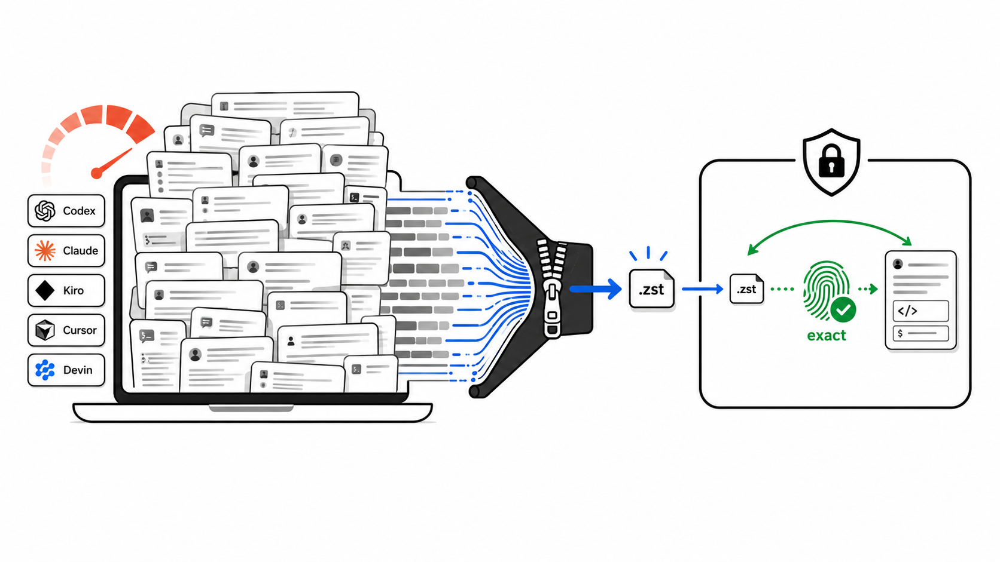
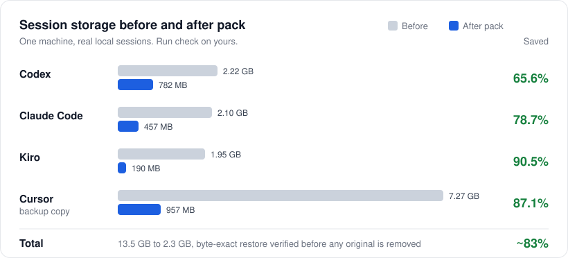

<p align="center">
  <a href="https://github.com/YosefHayim/agent-session-pack"></a>
</p>

<p align="center">
  <strong>ローカルの AI コーディングエージェントセッションのコールドストレージ。Codex、Claude Code、Kiro、Grok、Kimi、OpenCode、Gemini CLI の履歴をディスク上で縮小し、復元時にすべてのバイトを取り戻します。</strong>
</p>

<p align="center">
  <a href="https://www.npmjs.com/package/agent-session-pack"></a>
  <a href="https://www.npmjs.com/package/agent-session-pack"></a>
  <a href="https://github.com/YosefHayim/agent-session-pack/actions/workflows/ci.yml"></a>
  <a href="LICENSE"></a>
  
</p>

<p align="center">
  
  
  
  
</p>

<p align="center">
  <a href="README.md">English</a> · <strong>日本語</strong> · <a href="README.he.md">עברית</a> · <a href="README.es.md">Español</a> · <a href="README.zh-CN.md">简体中文</a>
</p>

---

**Agent Session Pack** は、ローカルのセッション履歴が大きくなった開発者とコーディングエージェントのための [Node.js](https://nodejs.org/en) CLI です。[OpenAI Codex CLI](https://developers.openai.com/codex/cli)、[Claude Code](https://code.claude.com/docs/en/overview)、[Kiro CLI](https://kiro.dev/docs/cli/)、[Grok](https://grok.x.ai/)、[Kimi Code](https://www.kimi.com/)、[OpenCode](https://opencode.ai/)、[Gemini CLI](https://geminicli.com/)、[Cursor](https://cursor.com/docs)、[Devin CLI](https://docs.devin.ai/cli) のセッションストアを見つけ、コピー上でロスレスな [Zstandard](https://facebook.github.io/zstd/) 圧縮を証明し、依頼されたときだけコールドセッションをローカルの保管庫にパックします。すべてのパックは、元ファイルを削除する前にアーカイブを復元して SHA-256 ハッシュを比較します。

デーモンなし、クラウド同期なし、要約なし。セッションがマシンの外に出ることはありません。

## 目次

- [特長](#特長)
- [対応エージェント](#対応エージェント)
- [ベンチマーク](#ベンチマーク)
- [Agent Session Pack と削除や圧縮の比較](#agent-session-pack-と削除や圧縮の比較)
- [ワンクリックAI設定](#ワンクリックai設定)
- [クイックスタート](#クイックスタート)
- [コマンド](#コマンド)
- [ライフサイクル: 起動時の自動復元](#ライフサイクル-起動時の自動復元)
- [安全モデル](#安全モデル)
- [Hello world 例](#hello-world-例)
- [代替ツール](#代替ツール)
- [よくある質問](#よくある質問)
- [コントリビュート](#コントリビュート)
- [リソース](#リソース)
- [ライセンス](#ライセンス)
- [コントリビューター](#コントリビューター)

## 特長

- **9 種のコーディングエージェント** - Codex、Claude Code、Kiro、Grok、Kimi Code、OpenCode、Gemini CLI はパックと復元に対応しています。Cursor と Devin はバックアップ専用です。
- **変更前に証明** - `check` はエージェントごとに 1 セッションをコピーし、圧縮し、復元して、ハッシュを比較します。実ファイルは変更されません。
- **バイト単位の復元** - すべてのアーカイブは、元ファイルを削除する前に復元され、SHA-256 で検証されます。
- **デフォルトはドライラン** - `--apply` を付けないと何も削除されません。`--apply` は `--yes` を付けない限り確認を求めます。
- **コールドセッションのフィルター** - `--older-than 7d`（または `12h`、`1d`、`2w`、`30d`）で、進行中の作業には触れません。
- **エージェント向けの設計** - `guide --json` は安全なコマンドの一覧を出力します。scan、check、pack、unpack、restore、lifecycle コマンドは、プロンプトなしで安定した `--json` 出力を持ちます。
- **オプトインのライフサイクル** - プロバイダーのラッパーは、パック済みセッションを開いたときに復元し、`maintain` はコールドになったものを再パックします。
- **ローカルファースト** - デーモンなし、ネットワークなし、認証情報の読み取りなし。

## 対応エージェント

| エージェント | モード           | セッションストア                                                     |
| ------------ | ---------------- | -------------------------------------------------------------------- |
| Codex        | アーカイブ       | `~/.codex/sessions`                                                  |
| Claude Code  | アーカイブ       | `~/.claude/projects`                                                 |
| Kiro         | アーカイブ       | `~/.kiro/sessions`                                                   |
| Grok         | アーカイブ       | `~/.grok/sessions`（セッションフォルダ単位）                         |
| Kimi Code    | アーカイブ       | `~/.kimi-code/sessions`（セッションフォルダ単位）                    |
| OpenCode     | アーカイブ       | `~/.local/share/opencode`、`~/.opencode`                             |
| Gemini CLI   | アーカイブ       | `~/.gemini`、`~/.gemini/tmp`                                         |
| Cursor       | バックアップ専用 | `~/Library/Application Support/Cursor`                               |
| Devin        | バックアップ専用 | `~/.local/share/devin/cli`（`sessions.db` のメタデータのみ読み取り） |

**アーカイブ** は、セッションを保管庫にパックして復元できることを意味します。**バックアップ専用** は、エージェントが対応として掲載されていますが、ネイティブストアは決して変更されないことを意味します。Cursor の検出は現在、セッションを返しません。

## ベンチマーク

<p align="center">
  
</p>

| エージェント                   |          前 |         後 |       削減 |
| ------------------------------ | ----------: | ---------: | ---------: |
| Codex                          |     2.22 GB |     782 MB |  **65.6%** |
| Claude Code                    |     2.10 GB |     457 MB |  **78.7%** |
| Kiro                           |     1.95 GB |     190 MB |  **90.5%** |
| Cursor（バックアップのコピー） |     7.27 GB |     957 MB |  **87.1%** |
| **合計**                       | **13.5 GB** | **2.3 GB** | **約 83%** |

これは 1 台のマシンの実際のセッション履歴であり、万能のベンチマークではありません。`npx --yes agent-session-pack check` を実行すると、お使いのマシンで測定できます。コピーに対してのみ動作します。

## Agent Session Pack と削除や圧縮の比較

|                                        | **Agent Session Pack**             | **古いファイルを削除** | **zstd や tar を手作業で** |
| -------------------------------------- | ---------------------------------- | ---------------------- | -------------------------- |
| セッションを取り戻す                   | バイト単位で、削除前に検証         | 完全に失われる         | 自分で確認した場合のみ     |
| 各エージェントのストアを見つける       | 9 種を組み込みで対応               | パスを自分で探す       | パスを自分で探す           |
| ファイルを元の場所に戻す               | セッションごとの復元マニフェスト   | 該当なし               | パスは自分で管理           |
| 復元時に変更されたファイル             | スキップされ、決して上書きされない | 該当なし               | 黙って上書きされる         |
| 複数ファイルのセッション（Grok、Kimi） | フォルダ全体としてパック           | 半分だけ削除しやすい   | ファイルを見落としやすい   |
| 事前に確認                             | ドライランがデフォルト             | いいえ                 | いいえ                     |

## ワンクリックAI設定

> **コーディングエージェントに実行させましょう。** 下のプロンプトを Claude Code、Codex、またはシェルを使えるエージェントにコピーしてください。

<details>
<summary><strong>クリックして AI 設定プロンプトをコピー</strong></summary>

```
I want to free disk space used by my local AI coding-agent sessions with
Agent Session Pack (https://github.com/YosefHayim/agent-session-pack).

Please:
1. Check that Node.js 22+ and zstd are installed. If zstd is missing, tell me how to install it on my OS.
2. Run: npx --yes agent-session-pack guide --json
   and follow its safe command map.
3. Run: npx --yes agent-session-pack check --json
   and show me the before/after savings per agent. This only touches copies.
4. Run: npx --yes agent-session-pack pack --all-providers --older-than 7d --dry-run --json
   and show me which sessions would be packed.
5. Stop and ask me before running anything with --apply.
```

</details>

## クイックスタート

### 1. 必要なもの

- [Node.js](https://nodejs.org/en) 22 以降。
- 検証、パック、復元のための、`PATH` 上の [`zstd`](https://facebook.github.io/zstd/)。
- Devin を使う場合のみ `sqlite3`。
- シェルで `HOME` が設定されていること（macOS と Linux では通常どおり。[`.env.example`](.env.example) を参照）。

`npx --yes agent-session-pack doctor` を実行すると確認できます。

### 2. コピーで削減量を証明

```bash
npx --yes agent-session-pack check
```

`check` は、エージェントごとに 1 セッションを一時的な作業領域にコピーし、圧縮し、復元して、ハッシュを比較し、前後の比較表を表示します。実際のセッションファイルは変更されません。

### 3. パック対象をプレビュー

```bash
npx --yes agent-session-pack pack --all-providers --older-than 7d --dry-run
```

### 4. コールドセッションをパック

```bash
npx --yes agent-session-pack pack --all-providers --older-than 7d --apply
```

各セッションは `~/.agent-session-pack` にアーカイブされ、復元してハッシュを確認され、マニフェストに記録されたあとで初めて、エージェントのストアから削除されます。

### 5. 必要なときに復元

```bash
npx --yes agent-session-pack unpack --all-providers --apply   # すべて
npx --yes agent-session-pack restore SESSION_ID_OR_NAME       # 1 セッション
```

`restore` と `open` は、セッション ID またはその先頭数文字、名前、slug、名前の一部の単語を受け付けます。`codex:` のようなプレフィックスを付けると、1 つのエージェントだけを検索できます。複数のセッションが一致した場合は、何も復元されず、一致したものが一覧表示されます。

ガイド付きメニューがよいですか。ターミナルで引数なしの `npx --yes agent-session-pack` を実行してください。コマンドをパスに通したい場合は、`npm install -g agent-session-pack` でグローバルにインストールできます。

## コマンド

| コマンド                            | 内容                                                                             | ファイルを変更 |
| ----------------------------------- | -------------------------------------------------------------------------------- | -------------- |
| `guide [--json]`                    | エージェントと自動化のための安全なコマンド一覧                                   | いいえ         |
| `check [--json]`                    | インストール不要の、コピーに対する削減証明                                       | いいえ         |
| `savings [--json]`                  | 同じコピー限定の前後比較                                                         | いいえ         |
| `scan [--json]`                     | セッションストア、サイズ、コールドの候補を一覧表示                               | いいえ         |
| `doctor [--json]`                   | `zstd` と `sqlite3` がインストールされているか確認                               | いいえ         |
| `init`                              | 保管庫のポリシーを表示。ターミナルでは設定を書き込むガイド付きセットアップを開く | 設定のみ       |
| `pack --dry-run`                    | パックするコールドセッションをプレビュー                                         | いいえ         |
| `pack --apply [--yes]`              | アーカイブし、検証してから元ファイルを削除                                       | はい           |
| `unpack --apply [--yes]`            | アーカイブ済みセッションを元のパスに復元                                         | はい           |
| `restore <selector>`                | ID、ID の先頭、名前、slug、名前の単語で 1 セッションを復元                       | はい           |
| `open <session>`                    | 同じ方法でセッションを探し、パック済みなら復元                                   | はい           |
| `lifecycle enable\|disable\|status` | 自動復元ラッパーをインストールまたは削除                                         | ラッパーと設定 |
| `maintain --apply [--yes]`          | 再びコールドになったセッションを再パック                                         | はい           |

`preflight`、`watch`、`ensure-restored` はライフサイクルのラッパーから呼び出されるため、普段は直接実行しません。

共通のフラグ: `--provider <id>`、`--all-providers`、`--older-than`、`--json`。エージェント ID は `codex`、`claude`、`kiro`、`grok`、`kimi`、`opencode`、`gemini`、`cursor`、`devin` です。

<details>
<summary><strong><code>--older-than</code> の選び方</strong></summary>

| 値                | 用途                                                                                   |
| ----------------- | -------------------------------------------------------------------------------------- |
| `12h`             | 短いクリーンアップの期間                                                               |
| `1d`              | 今日の作業をほぼ除外                                                                   |
| `7d`              | 設定のデフォルトポリシー                                                               |
| `30d`             | 控えめなアーカイブの実行                                                               |
| `--max --dry-run` | アーカイブモードのすべてのセッションの好奇心によるプレビュー（`--apply` と併用しない） |

</details>

`npx --yes` が承認するのは npm の一時パッケージのダウンロードだけです。Agent Session Pack は、独自の確認を `--apply` で求め、自動化では `--yes` を使います。

## ライフサイクル: 起動時の自動復元

ライフサイクルは有効にするまでオフです。有効にすると、エージェントがパック済みのセッションを開いたときに、自動で復元されます。

```bash
# 一度だけ
npx --yes agent-session-pack lifecycle enable --json
export PATH="$HOME/.agent-session-pack/bin:$PATH"

# 1 セッションを開くか再開（パック済みなら先に復元）
npx --yes agent-session-pack open --provider grok SESSION_ID --json

# 復元後もストレージを小さく保つ
npx --yes agent-session-pack maintain --apply --yes --json
```

- ラッパー（`codex`、`claude`、`grok` など）は、コマンドラインのセッション ID に対して `preflight` を実行し、エージェントの実行中は `watch` を動かします。
- パック済みのセッションは、一覧に表示され続けるように小さなスタブを残します。エージェントがスタブを開くと、`watch` が完全なセッションを復元します。
- `maintain` は、設定の `coldAfter`（デフォルトは `7d`）より古いセッションを再パックします。デーモンはありません。必要なら cron または launchd でスケジュールしてください。
- `lifecycle disable` はラッパーを削除します。

## 安全モデル

Agent Session Pack は、ベストエフォートの整理ではなく、バイト単位の復元を中心に作られています。

- `check` と `savings` はコピーに対してのみ動作します。
- `pack --all-providers` は `--apply` を付けない限りドライランです。
- `pack --apply` は、`--yes` を付けない限りターミナルで確認を求めます。
- `pack --max --apply` は拒否されます。
- Apply はアーカイブを書き込み、復元し、SHA-256 の一致を確認し、マニフェストを書き込んでから、初めて元ファイルを削除します。
- `unpack --apply` はマニフェストから復元し、変更されたライブファイルは上書きせずスキップします。
- Grok と Kimi のセッションはフォルダ全体なので、フォルダ全体としてパックと復元が行われます。
- Cursor と Devin はバックアップ専用です。そのネイティブストアは決して変更されません。

## Hello world 例

[`examples/hello-world`](examples/hello-world/) には、本物の `zstd` アーカイブと復元したコピーを含む、小さな合成セッションが 3 つあります。2 つのコマンドで、アーカイブが正確なバイト列を復元することを確認できます:

```bash
shasum -a 256 < examples/hello-world/before/codex-session.jsonl
zstd -d -c examples/hello-world/archives/codex-session.jsonl.zst | shasum -a 256
```

## 代替ツール

Agent Session Pack は意図的に範囲を絞っています。ローカルのコールドなセッションファイルをアーカイブし、バイト単位の復元を検証します。使用量、検索、ディスク分析のツールと組み合わせるのに適しています。

| ツール                                                                                  | 主な目的                                             | 違い                                                                           |
| --------------------------------------------------------------------------------------- | ---------------------------------------------------- | ------------------------------------------------------------------------------ |
| [`ccusage`](https://ccusage.com/guide/)                                                 | コーディングエージェントのトークンとコストのレポート | 使用量を説明するだけで、セッションストアはパックしない。                       |
| [`claude-code-history-viewer`](https://github.com/jhlee0409/claude-code-history-viewer) | AI コーディング履歴のオフラインでの閲覧と検索        | 履歴を見るだけで、アーカイブや復元はしない。                                   |
| [`claude-code-cleaner`](https://github.com/garrickz2/claude-code-cleaner)               | Claude Code のディスク掃除                           | Claude のみ。検証済みの複数エージェント用保管庫はない。                        |
| `zstd`、`tar`、バックアップ、ディスク分析ツール                                         | 汎用のストレージツール                               | バイトを圧縮または探すだけで、エージェントのセッションや復元パスは分からない。 |

## よくある質問

<details>
<summary><strong>これはコンテキストの圧縮や要約ですか。</strong></summary>

いいえ。Agent Session Pack は、会話を要約、書き換え、切り詰めることは決してありません。ロスレス圧縮を使い、バイト単位の復元を検証します。
</details>

<details>
<summary><strong>パック後もエージェントはセッションを再開できますか。</strong></summary>

はい。再開する前に `restore` または `open` でセッションを復元するか、エージェントが開いたときに自動で行われるように[ライフサイクル](#ライフサイクル-起動時の自動復元)を有効にしてください。
</details>

<details>
<summary><strong>セットアップは後から自動でセッションを圧縮しますか。</strong></summary>

セットアップだけでは設定を保存するだけです。パックは `pack --apply` を実行したとき、または `lifecycle enable` の後に `maintain --apply` を実行したときに行われます。バックグラウンドでは何も動きません。
</details>

<details>
<summary><strong>今日の分を除いて古いセッションだけパックするには？</strong></summary>

```bash
npx --yes agent-session-pack pack --all-providers --older-than 1d --apply
```
</details>

<details>
<summary><strong>認証情報を読んだり、セッションをアップロードしたりしますか。</strong></summary>

いいえ。ローカルのストアをスキャンし、ローカルのアーカイブを書き込みます。Devin の場合は、ローカルの SQLite データベースからセッションのメタデータを読み取りますが、認証情報は決して読みません。
</details>

<details>
<summary><strong>古いセッションファイルを削除するのとは何が違いますか。</strong></summary>

削除は元に戻せません。Agent Session Pack はアーカイブを書き込み、元とまったく同じバイト列に復元できることを証明し、マニフェストを書き込んでから、初めて元ファイルを削除します。
</details>

<details>
<summary><strong>アーカイブはどこに保存されますか。</strong></summary>

保管庫 `~/.agent-session-pack` にあります。圧縮された `.zst` アーカイブと、元のパスと SHA-256 ハッシュを記録したセッションごとの JSON マニフェストが 1 つずつ保存されます。
</details>

## コントリビュート

コントリビューションを歓迎します。フォークし、ブランチを作成し、テストを追加し、チェックを実行し、[Conventional Commits](https://www.conventionalcommits.org/) でコミットして、PR を作成してください。エージェント向けのルールは [AGENTS.md](AGENTS.md) にあります。

```bash
pnpm install
pnpm check        # Turborepo による lint、typecheck、test、build
pnpm lint:fix     # Biome の修正を書き込む
pnpm test:watch   # Vitest のウォッチモード。テストは合成データのみを使用
pnpm dev          # ソースから CLI を実行（例: pnpm dev doctor）
pnpm prod         # ビルドしてから、ビルド済みの CLI を実行
```

テストが実際のセッションフォルダを読み取ったり変更したりすることはありません。

## リソース

プロジェクトのドキュメント:

- [PROJECT.md](PROJECT.md) - 目的、利用者、対象外の範囲。
- [llms.txt](llms.txt) - AI エージェント向けのプロジェクト概要。
- [リリース](https://github.com/YosefHayim/agent-session-pack/releases) と [Issue トラッカー](https://github.com/YosefHayim/agent-session-pack/issues)。

使用技術:

- [TypeScript](https://www.typescriptlang.org/)、[Effect](https://effect.website/docs)、[citty](https://github.com/unjs/citty)、[Clack](https://bomb.sh/docs/clack/basics/getting-started/)。
- [pnpm](https://pnpm.io/)、[Vitest](https://vitest.dev/)、[Biome](https://biomejs.dev/)、[tsup](https://tsup.egoist.dev/)、[GitHub Actions](https://docs.github.com/en/actions)。
- [Zstandard](https://facebook.github.io/zstd/) と [llms.txt](https://llmstxt.org/) の慣習。

## ライセンス

MIT - [LICENSE](LICENSE) を参照。

## コントリビューター

このプロジェクトを良くしてくれたすべての方に感謝します。

<a href="https://github.com/YosefHayim/agent-session-pack/graphs/contributors">
  
</a>

---

<div align="center">

<a href="https://www.buymeacoffee.com/yosefhayim" target="_blank"></a>

<br /><br />

**[このプロジェクトを支援](https://www.buymeacoffee.com/yosefhayim)** · 作成者 [Yosef Hayim Sabag](https://github.com/YosefHayim)

<sub>Agent Session Pack · ローカルの AI コーディングエージェントセッションのコールドストレージ · Codex、Claude Code、Kiro、Grok、Kimi、OpenCode、Gemini CLI のバイト単位の zstd アーカイブと復元。</sub>

</div>
