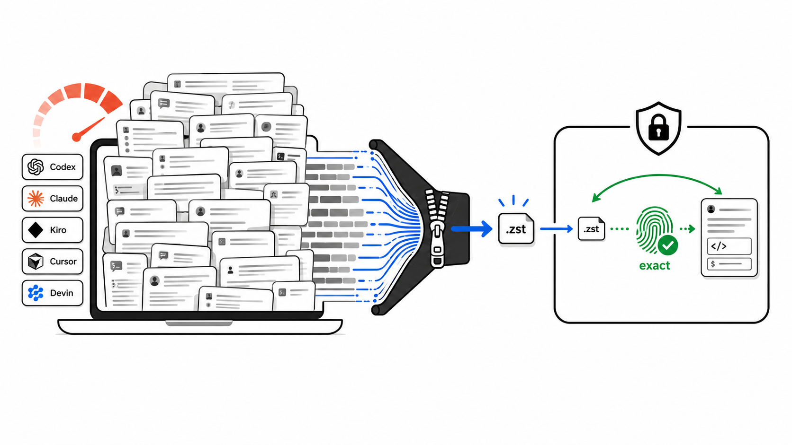
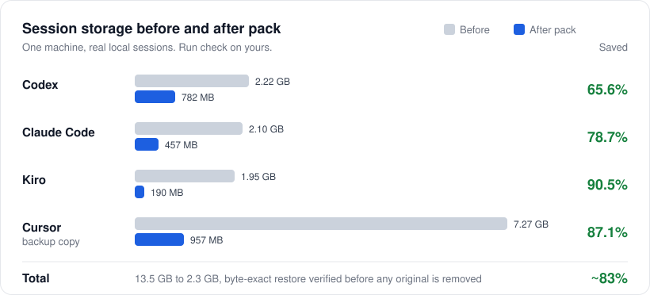

<p align="center">
  <a href="https://github.com/YosefHayim/agent-session-pack"></a>
</p>

<p align="center">
  <strong>本地 AI 编程代理会话的冷存储。在磁盘上缩小 Codex、Claude Code、Kiro、Grok、Kimi、OpenCode 和 Gemini CLI 的历史记录，还原时每个字节都能找回。</strong>
</p>

<p align="center">
  <a href="https://www.npmjs.com/package/agent-session-pack"></a>
  <a href="https://www.npmjs.com/package/agent-session-pack"></a>
  <a href="https://github.com/YosefHayim/agent-session-pack/actions/workflows/ci.yml"></a>
  <a href="LICENSE"></a>
  
</p>

<p align="center">
  
  
  
  
</p>

<p align="center">
  <a href="README.md">English</a> · <a href="README.ja.md">日本語</a> · <a href="README.he.md">עברית</a> · <a href="README.es.md">Español</a> · <strong>简体中文</strong>
</p>

---

**Agent Session Pack** 是一个 [Node.js](https://nodejs.org/en) 命令行工具，面向本地会话历史已经变得很大的开发者和编程代理。它会找到 [OpenAI Codex CLI](https://developers.openai.com/codex/cli)、[Claude Code](https://code.claude.com/docs/en/overview)、[Kiro CLI](https://kiro.dev/docs/cli/)、[Grok](https://grok.x.ai/)、[Kimi Code](https://www.kimi.com/)、[OpenCode](https://opencode.ai/)、[Gemini CLI](https://geminicli.com/)、[Cursor](https://cursor.com/docs) 和 [Devin CLI](https://docs.devin.ai/cli) 的会话存储，在副本上证明无损的 [Zstandard](https://facebook.github.io/zstd/) 压缩，并且只在你要求时才把冷会话打包进本地保险库。每次打包都会先还原归档并比较 SHA-256 哈希，然后才删除原始文件。

没有守护进程，没有云同步，没有摘要。你的会话不会离开你的机器。

## 目录

- [功能](#功能)
- [支持的代理](#支持的代理)
- [基准数据](#基准数据)
- [Agent Session Pack 与删除或压缩对比](#agent-session-pack-与删除或压缩对比)
- [一键 AI 设置](#一键-ai-设置)
- [快速开始](#快速开始)
- [命令](#命令)
- [生命周期：启动时自动还原](#生命周期启动时自动还原)
- [安全模型](#安全模型)
- [Hello world 示例](#hello-world-示例)
- [替代工具](#替代工具)
- [常见问题](#常见问题)
- [参与贡献](#参与贡献)
- [资源](#资源)
- [许可证](#许可证)
- [贡献者](#贡献者)

## 功能

- **9 种编程代理** - Codex、Claude Code、Kiro、Grok、Kimi Code、OpenCode 和 Gemini CLI 可以打包和还原；Cursor 和 Devin 仅支持备份。
- **改动前先证明** - `check` 为每个代理复制一个会话，压缩、还原后比较哈希。真实文件不会被改动。
- **逐字节还原** - 每个归档在删除原始文件前都会被还原，并用 SHA-256 校验。
- **默认只预览** - 不加 `--apply` 不会删除任何内容；`--apply` 默认会先询问，除非你传入 `--yes`。
- **冷会话过滤** - `--older-than 7d`（或 `12h`、`1d`、`2w`、`30d`）不会动你正在进行的工作。
- **为代理而设计** - `guide --json` 输出安全的命令列表；scan、check、pack、unpack、restore 和 lifecycle 命令都有稳定的 `--json` 输出，且不会提示输入。
- **可选的生命周期** - 提供方包装器会在你打开已打包的会话时把它还原，`maintain` 则会重新打包变冷的会话。
- **本地优先** - 没有守护进程，没有网络，不读取凭据。

## 支持的代理

| 代理 | 模式 | 会话存储 |
| --- | --- | --- |
| Codex | 归档 | `~/.codex/sessions` |
| Claude Code | 归档 | `~/.claude/projects` |
| Kiro | 归档 | `~/.kiro/sessions` |
| Grok | 归档 | `~/.grok/sessions`（整个会话文件夹） |
| Kimi Code | 归档 | `~/.kimi-code/sessions`（整个会话文件夹） |
| OpenCode | 归档 | `~/.local/share/opencode`、`~/.opencode` |
| Gemini CLI | 归档 | `~/.gemini`、`~/.gemini/tmp` |
| Cursor | 仅备份 | `~/Library/Application Support/Cursor` |
| Devin | 仅备份 | `~/.local/share/devin/cli`（只读取 `sessions.db` 的元数据） |

**归档** 表示会话可以打包进保险库并还原。**仅备份** 表示该代理已列为支持，但它的原生存储从不会被修改。目前 Cursor 的发现功能不会返回任何会话。

## 基准数据

<p align="center">
  
</p>

| 代理 | 之前 | 之后 | 节省 |
| --- | ---: | ---: | ---: |
| Codex | 2.22 GB | 782 MB | **65.6%** |
| Claude Code | 2.10 GB | 457 MB | **78.7%** |
| Kiro | 1.95 GB | 190 MB | **90.5%** |
| Cursor（备份副本） | 7.27 GB | 957 MB | **87.1%** |
| **合计** | **13.5 GB** | **2.3 GB** | **约 83%** |

这是一台机器的真实会话历史，并非通用基准。运行 `npx --yes agent-session-pack check` 即可测量你自己的数据；它只在副本上工作。

## Agent Session Pack 与删除或压缩对比

| | **Agent Session Pack** | **删除旧文件** | **手动 zstd 或 tar** |
| --- | --- | --- | --- |
| 取回会话 | 逐字节，删除前校验 | 永久丢失 | 只有你自己检查才行 |
| 找到每个代理的存储 | 内置支持 9 种代理 | 你需要自己找路径 | 你需要自己找路径 |
| 把文件放回代理期望的位置 | 每个会话一份还原清单 | 不适用 | 你自己跟踪路径 |
| 还原时已改动的文件 | 跳过，从不覆盖 | 不适用 | 会被悄悄覆盖 |
| 多文件会话（Grok、Kimi） | 作为整个文件夹打包 | 容易只删掉一半 | 容易漏掉文件 |
| 先预览 | 默认就是预览 | 否 | 否 |

## 一键 AI 设置

> **让你的编程代理替你运行。** 把下面的提示词复制到 Claude Code、Codex 或任何有终端的代理中。

<details>
<summary><strong>点击复制 AI 设置提示词</strong></summary>

```
I want to free disk space used by my local AI coding-agent sessions with
Agent Session Pack (https://github.com/YosefHayim/agent-session-pack).

Please:
1. Check that Node.js 22+ and zstd are installed. If zstd is missing, tell me how to install it on my OS.
2. Run: npx --yes agent-session-pack guide --json
   and follow its safe command map.
3. Run: npx --yes agent-session-pack check --json
   and show me the before/after savings per agent. This only touches copies.
4. Run: npx --yes agent-session-pack pack --all-providers --older-than 7d --dry-run --json
   and show me which sessions would be packed.
5. Stop and ask me before running anything with --apply.
```

</details>

## 快速开始

### 1. 检查环境要求

- [Node.js](https://nodejs.org/en) 22 或更新版本。
- 在你的 `PATH` 中有 [`zstd`](https://facebook.github.io/zstd/)，用于证明、打包和还原。
- 只有使用 Devin 时才需要 `sqlite3`。
- 你的 shell 中设置了 `HOME`（macOS 和 Linux 通常如此；参见 [`.env.example`](.env.example)）。

运行 `npx --yes agent-session-pack doctor` 即可检查这些条件。

### 2. 在副本上证明节省空间

```bash
npx --yes agent-session-pack check
```

`check` 会为每个代理把一个会话复制到临时工作区，压缩、还原、比较哈希，并输出前后对比表。真实的会话文件保持不变。

### 3. 预览将要打包的内容

```bash
npx --yes agent-session-pack pack --all-providers --older-than 7d --dry-run
```

### 4. 打包冷会话

```bash
npx --yes agent-session-pack pack --all-providers --older-than 7d --apply
```

每个会话都会归档到 `~/.agent-session-pack`，还原并校验哈希，记录到清单中，然后才会从代理的存储中删除。

### 5. 需要时还原

```bash
npx --yes agent-session-pack unpack --all-providers --apply   # 全部
npx --yes agent-session-pack restore SESSION_ID_OR_NAME       # 单个会话
```

`restore` 和 `open` 接受会话 ID 或其前几个字符、名称、slug，或名称中的几个词。加上 `codex:` 这样的前缀可以只搜索某一个代理。如果有多个会话匹配，则不会还原任何内容，并列出所有匹配项。

想要引导式菜单？在终端中不带参数运行 `npx --yes agent-session-pack`。如果想让命令在你的 PATH 中可用，可以用 `npm install -g agent-session-pack` 全局安装。

## 命令

| 命令 | 作用 | 是否修改文件 |
| --- | --- | --- |
| `guide [--json]` | 供代理和自动化使用的安全命令列表 | 否 |
| `check [--json]` | 无需安装，在副本上证明节省空间 | 否 |
| `savings [--json]` | 同样只在副本上运行的前后对比证明 | 否 |
| `scan [--json]` | 列出会话存储、大小和冷会话候选 | 否 |
| `doctor [--json]` | 检查 `zstd` 和 `sqlite3` 是否已安装 | 否 |
| `init` | 显示保险库策略；在终端中打开引导式设置，写入配置 | 仅配置 |
| `pack --dry-run` | 预览将要打包的冷会话 | 否 |
| `pack --apply [--yes]` | 归档、校验，然后删除原始文件 | 是 |
| `unpack --apply [--yes]` | 把已归档的会话还原到原始路径 | 是 |
| `restore <selector>` | 按 ID、ID 前缀、名称、slug 或名称中的词还原一个会话 | 是 |
| `open <session>` | 以同样的方式查找会话，若已打包则还原 | 是 |
| `lifecycle enable\|disable\|status` | 安装或移除自动还原包装器 | 包装器和配置 |
| `maintain --apply [--yes]` | 重新打包再次变冷的会话 | 是 |

`preflight`、`watch` 和 `ensure-restored` 由生命周期包装器调用；你很少需要自己运行它们。

常用选项：`--provider <id>`、`--all-providers`、`--older-than`、`--json`。代理 ID 为 `codex`、`claude`、`kiro`、`grok`、`kimi`、`opencode`、`gemini`、`cursor` 和 `devin`。

<details>
<summary><strong>如何选择 <code>--older-than</code></strong></summary>

| 值 | 适用场景 |
| --- | --- |
| `12h` | 短时间的清理窗口 |
| `1d` | 大致跳过今天正在进行的工作 |
| `7d` | 默认的配置策略 |
| `30d` | 保守的归档一轮 |
| `--max --dry-run` | 好奇地预览所有归档模式的会话（不要与 `--apply` 一起使用） |

</details>

`npx --yes` 只批准 npm 临时下载包的操作。Agent Session Pack 通过 `--apply` 请求它自己的确认，自动化场景则使用 `--yes`。

## 生命周期：启动时自动还原

生命周期默认关闭，直到你启用它。启用后，代理打开已打包的会话时，会话会自动恢复。

```bash
# 只需一次
npx --yes agent-session-pack lifecycle enable --json
export PATH="$HOME/.agent-session-pack/bin:$PATH"

# 打开或恢复一个会话（如果已打包，先还原）
npx --yes agent-session-pack open --provider grok SESSION_ID --json

# 还原后保持存储空间较小
npx --yes agent-session-pack maintain --apply --yes --json
```

- 包装器（`codex`、`claude`、`grok` 等）会对命令行中的会话 ID 运行 `preflight`，并在代理运行期间运行 `watch`。
- 已打包的会话会留下很小的存根，以便仍然可以列出。代理打开存根时，`watch` 会还原完整的会话。
- `maintain` 会重新打包早于你配置的 `coldAfter`（默认 `7d`）的会话。没有守护进程；如果需要，可以用 cron 或 launchd 定时运行。
- `lifecycle disable` 会移除包装器。

## 安全模型

Agent Session Pack 围绕逐字节还原构建，而不是尽力而为的清理。

- `check` 和 `savings` 只在副本上工作。
- `pack --all-providers` 默认是预览，除非你传入 `--apply`。
- `pack --apply` 在终端中会请求确认，除非你传入 `--yes`。
- `pack --max --apply` 会被拒绝。
- Apply 会先写入归档，再还原它，检查 SHA-256 是否相等，写入清单，然后才删除原始文件。
- `unpack --apply` 从清单还原，遇到已变化的现有文件会跳过，而不是覆盖。
- Grok 和 Kimi 的会话是整个文件夹，因此按整个文件夹打包和还原。
- Cursor 和 Devin 仅支持备份：它们的原生存储从不会被修改。

## Hello world 示例

[`examples/hello-world`](examples/hello-world/) 包含三个很小的合成会话，以及它们真实的 `zstd` 归档和还原后的副本。两条命令可以证明归档还原出了完全相同的字节：

```bash
shasum -a 256 < examples/hello-world/before/codex-session.jsonl
zstd -d -c examples/hello-world/archives/codex-session.jsonl.zst | shasum -a 256
```

## 替代工具

Agent Session Pack 有意保持狭窄的范围：它归档本地冷会话文件，并校验逐字节还原。它可以很好地与用量、搜索和磁盘分析工具搭配使用。

| 工具 | 主要用途 | 区别 |
| --- | --- | --- |
| [`ccusage`](https://ccusage.com/guide/) | 编程代理的 token 和费用报告 | 解释用量；不打包会话存储。 |
| [`claude-code-history-viewer`](https://github.com/jhlee0409/claude-code-history-viewer) | AI 编程历史的离线浏览和搜索 | 查看历史；不归档也不还原。 |
| [`claude-code-cleaner`](https://github.com/garrickz2/claude-code-cleaner) | Claude Code 磁盘清理 | 仅支持 Claude；没有经过校验的多代理保险库。 |
| `zstd`、`tar`、备份、磁盘分析工具 | 通用存储工具 | 压缩或查找字节；不了解代理会话和还原路径。 |

## 常见问题

<details>
<summary><strong>这是上下文压缩或摘要吗？</strong></summary>

不是。Agent Session Pack 从不总结、改写或截断对话。它使用无损压缩，并校验逐字节还原。
</details>

<details>
<summary><strong>打包后代理还能恢复会话吗？</strong></summary>

可以。恢复前先用 `restore` 或 `open` 还原会话，或者启用[生命周期](#生命周期启动时自动还原)，让代理打开时自动完成。
</details>

<details>
<summary><strong>设置之后会不会自动压缩会话？</strong></summary>

仅设置本身只保存配置。打包发生在你运行 `pack --apply` 时，或在 `lifecycle enable` 之后运行 `maintain --apply` 时。没有任何内容在后台运行。
</details>

<details>
<summary><strong>怎样打包旧会话并跳过今天的？</strong></summary>

```bash
npx --yes agent-session-pack pack --all-providers --older-than 1d --apply
```
</details>

<details>
<summary><strong>它会读取凭据或上传会话吗？</strong></summary>

不会。它扫描本地存储并写入本地归档。对于 Devin，它从本地 SQLite 数据库读取会话元数据，从不读取凭据。
</details>

<details>
<summary><strong>这和删除旧会话文件有什么不同？</strong></summary>

删除是单向的。Agent Session Pack 会先写入归档，证明它能还原出与原始文件完全相同的字节，写入清单，然后才删除原始文件。
</details>

<details>
<summary><strong>归档存放在哪里？</strong></summary>

存放在保险库 `~/.agent-session-pack` 中：压缩的 `.zst` 归档，以及每个会话一个 JSON 清单，记录原始路径和 SHA-256 哈希。
</details>

## 参与贡献

欢迎贡献。请 fork、创建分支、添加测试、运行检查、使用 [Conventional Commits](https://www.conventionalcommits.org/) 提交，然后发起 PR。代理的规则位于 [AGENTS.md](AGENTS.md)。

```bash
pnpm install
pnpm check        # 通过 Turborepo 运行 lint、typecheck、test 和 build
pnpm lint:fix     # 写入 Biome 的修复
pnpm test:watch   # Vitest 监视模式；测试只使用合成数据
pnpm dev          # 从源码运行 CLI，例如 pnpm dev doctor
pnpm prod         # 构建后运行构建好的 CLI
```

测试从不读取或修改你真实的会话文件夹。

## 资源

项目文档：

- [PROJECT.md](PROJECT.md) - 目的、用户和非目标。
- [llms.txt](llms.txt) - 面向 AI 代理的项目简要说明。
- [发布版本](https://github.com/YosefHayim/agent-session-pack/releases)和[问题跟踪](https://github.com/YosefHayim/agent-session-pack/issues)。

技术栈：

- [TypeScript](https://www.typescriptlang.org/)、[Effect](https://effect.website/docs)、[citty](https://github.com/unjs/citty) 和 [Clack](https://bomb.sh/docs/clack/basics/getting-started/)。
- [pnpm](https://pnpm.io/)、[Vitest](https://vitest.dev/)、[Biome](https://biomejs.dev/)、[tsup](https://tsup.egoist.dev/) 和 [GitHub Actions](https://docs.github.com/en/actions)。
- [Zstandard](https://facebook.github.io/zstd/) 和 [llms.txt](https://llmstxt.org/) 约定。

## 许可证

MIT - 参见 [LICENSE](LICENSE)。

## 贡献者

感谢所有帮助改进这个项目的人。

<a href="https://github.com/YosefHayim/agent-session-pack/graphs/contributors">
  
</a>

---

<div align="center">

<a href="https://www.buymeacoffee.com/yosefhayim" target="_blank"></a>

<br /><br />

**[支持这个项目](https://www.buymeacoffee.com/yosefhayim)** · 作者 [Yosef Hayim Sabag](https://github.com/YosefHayim)

<sub>Agent Session Pack · 本地 AI 编程代理会话的冷存储 · 为 Codex、Claude Code、Kiro、Grok、Kimi、OpenCode 和 Gemini CLI 提供逐字节的 zstd 归档与还原。</sub>

</div>
